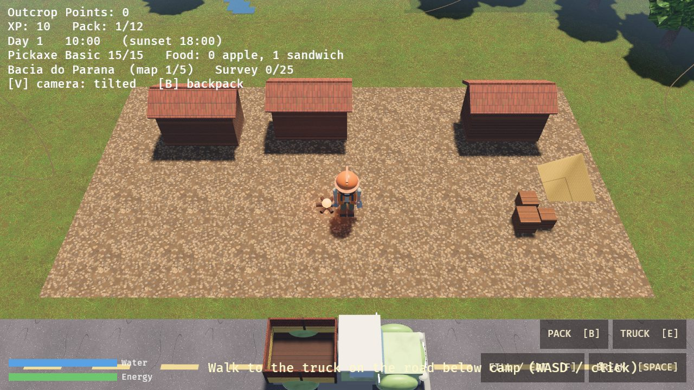
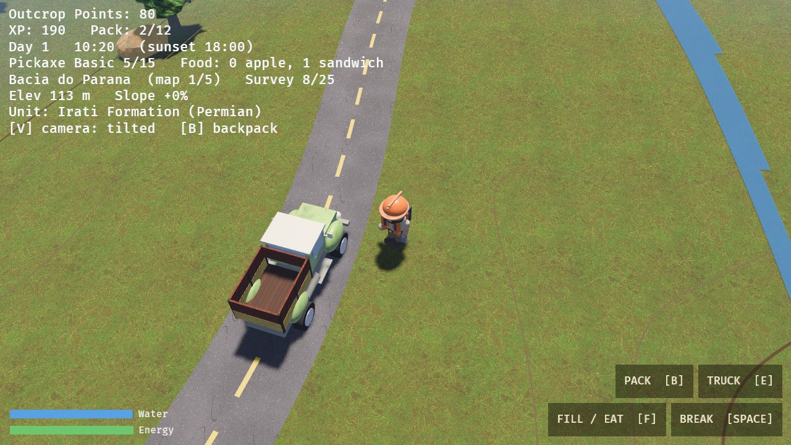
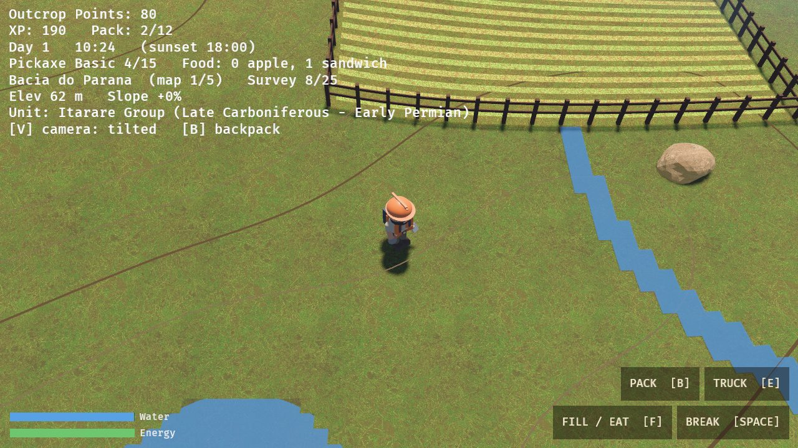
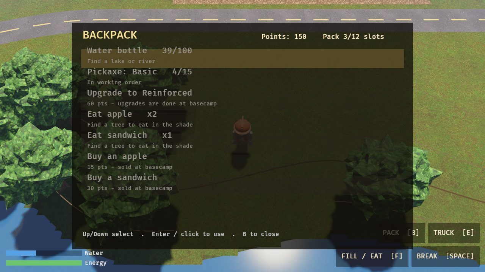

# Outcrops Odyssey

A geology open-world game: walk an endless field, break rock **outcrops**, and collect them as
**cards**. Each day starts at a basecamp, a truck drives you out along the main roads, and you must
be back on a road before sunset or the run is lost. Written in **Rust** with
[Macroquad](https://macroquad.rs), and playable **natively or in the browser** (WebAssembly),
on desktop and on phones.

The full design lives in `Outcrops_Odyssey_GDD.docx`.

## Screenshots

Captured from the Bevy 3D build (headless, software-rendered).

| Basecamp: cabins, crates, tent, campfire | The vintage pickup on a winding road |
|---|---|
|  |  |

| Fenced farm, river and contour lines | Backpack and camp store |
|---|---|
|  |  |

## Play

| | Desktop | Phone / tablet (landscape) |
|---|---|---|
| Move | WASD / arrows, or click the ground | Floating stick (hold anywhere lower-left), or tap the ground |
| Break an outcrop | SPACE, or click it | Tap it (walks over first if far), or the **BREAK** button |
| Board / call the truck | **E** (or click the truck) | Tap the truck, or **BOARD** / **TRUCK** |
| Map / cards | **M** / **C** (Up/Down pages) | **MAP** / **CARDS** buttons |
| Backpack & shop | **B** (Up/Down, ENTER to use) | **PACK** button |
| Fill bottle / eat (context) | **F** | **FILL** / **EAT** button |
| Restart after game over | ENTER | Tap |

The touch controls appear automatically on touch devices. The page blocks zoom and scrolling,
offers a fullscreen button, and asks portrait users to rotate. On iPhone Safari (no fullscreen
API) use Share → Add to Home Screen.

## The daily loop

1. Wake at the **basecamp** with a **full water bottle** and one apple or sandwich, walk to the truck
   on the road below camp, and board it.
2. The truck drives along the **main roads** to today's random drop point on the current map.
3. Explore and break outcrops. Field time runs **05:00 → 18:00**. Walking drains energy (more uphill,
   less downhill), and so does thirst. At 0 energy you move at half speed.
4. Stand on a main road and call the truck, or be on a road at sunset (automatic pickup).
   **Miss the road at 18:00 and it's game over.**
5. Back at camp you sleep (energy restored), and the next day begins. Cards, points and visited
   outcrops carry over. Once you have surveyed a map's **quota** of outcrops, the *next morning* you
   are taken to a new field area.

## Terrain

Every map has a topographic relief (0–300 m) drawn with hypsometric tint, hillshading and
**contour lines** (index contours every 75 m are labelled). Going **up** slows you and costs more
energy; going **down** is faster and cheaper. The HUD shows elevation and slope. Blocked areas:
**lakes**, **cliffs / very high mountains**, **dense forest** and **fenced farms** (rivers can be
waded, slowly). Maps are **bounded**: past the edge is the dark "edge of the survey area".

## Geology: one region per level

Each level is a hand-authored, bounded map of a Brazilian geological region. Outcrops only appear
where the rock is exposed (not in lakes, forest, farms) and every outcrop belongs to the
lithostratigraphic unit mapped at its location, so rocks, minerals and fossils match the region
(no Crato fossil fish in Carajás). The structure follows the geology: flat strata where older
units crop out lower, folded belts, or concentric rings around an intrusion.

| Level | Region | Units (examples) | Quota |
|---|---|---|---|
| 1 | Bacia do Paraná | Itararé Group, Irati Fm., Botucatu Fm., Serra Geral Fm. | 25 |
| 2 | Bacia do Araripe | Rio da Batateira, Crato, Ipubi, Romualdo, Exu formations | 25 |
| 3 | Quadrilátero Ferrífero | Basement gneiss, Nova Lima, Moeda, Batatal, Cauê, Gandarela, Cercadinho | 30 |
| 4 | Maciço de Poços de Caldas | Nepheline syenite, alkaline volcanics, basement, bauxite cover | 30 |
| 5 | Serra dos Carajás | Xingu Complex, granite, iron formation, canga | 35 |

The map screen (**M**) is a geological map: unit colours shaded by relief, with a legend giving
each unit and its age. Cards show the rock, unit, group and age plus any mineral or fossil found.

> **Data note:** the units, ages and mineral/fossil lists are compiled from published literature
> (SGB/CPRM, SciELO, university papers) and simplified for gameplay. Ages are rounded and
> approximate; verify against the [GeoSGB portal](https://geosgb.sgb.gov.br) before using them for
> anything but the game. The maps are authored, not imported from SGB shapefiles.

## The kit

- **Water bottle** (100): drains slowly, faster when walking. Fill at a lake or river (**F** /
  FILL) within reach. An empty bottle makes you slower and more tiring.
- **Pickaxe** with durability: rocks wear it (igneous/metamorphic twice as much). A broken pickaxe
  is replaced from the backpack menu for points (the next morning you always get a free basic one).
  **Upgrade** it at basecamp (Reinforced / Hardened / Tungsten).
- **Food**: buy apples (+20 energy) and sandwiches (+40) with points in the backpack menu. Eat
  only in the shade near a tree (or at camp); each morning you get one free piece of food.
- **Backpack**: 12 slots shared by food and bonus rocks.

## What's implemented (from the GDD)

- **Deterministic world** in 640-unit chunks derived from coordinates by a hash.
- **Outcrops**: the first break awards 10 points + 20 XP and marks the outcrop *visited*. The
  chance of a mineral or a fossil depends on the unit (see `src/geology.rs`); bonus rocks stay a
  flat 5%.
- **Cards**, **map**, **basecamp / roads / truck**, field clock, energy, "nearest road" compass and
  sunset warning.

> Differences from the original design: there is no free noon energy any more (food replaces it).

## Not built yet

- Task list (and the "Task completed" animation)
- XP leveling with Strength / Stamina progression
- Main menu: player naming ("Dr Geologist: name"), save / load / new game, leaderboard
- Onboarding tutorial
- Shared world state across players (needs a backend; outcrop state is per session today)

## Project layout

```
src/world.rs      deterministic chunk generation (region-aware), roads, basecamp, truck routing
src/terrain.rs    elevation, slopes, contours, lakes / rivers / forest / farms / cliffs
src/geology.rs    the five Brazilian regions: units, structure, minerals, fossils
src/kit.rs        water bottle, pickaxe tiers, food, backpack menu data
src/game.rs       rules and state machine (Basecamp → TruckOut → Exploring → TruckBack → Sleeping / GameOver)
src/touch.rs      on-screen buttons and virtual stick (pure logic)
src/main.rs       window, fixed 60 Hz loop, input, drawing, letterboxed 1280×720 screen
assets/           sprites and fonts (DejaVu, free license)
web-template/     index.html + miniquad's gl.js loader for the browser build
server.js         zero-dependency static server used on Railway
Dockerfile        builds the Bevy 3D wasm, then serves it with server.js (Railway default)
Dockerfile.macroquad  the 2D Macroquad web build (set as Dockerfile path on Railway to serve it)
railway.json      Railway config (Dockerfile build, /healthz health check)
.github/workflows CI: cargo test + wasm build
bevy-prototype/   3D renderer prototype (Bevy) reusing src/game.rs + src/world.rs — see its README
```

`game.rs`, `world.rs`, `terrain.rs`, `geology.rs`, `kit.rs` and `touch.rs` contain no rendering or window code, so the whole game loop
is covered by headless unit tests (`cargo test`, ~90 tests): chunk determinism, unit-based drop rates,
backpack cap, terrain rules, level progression, truck routes staying on roads, sunset game over, the full day loop, tap
interactions and touch routing.

## Run it

**Natively**

```fish
cargo run --release
```

**In the browser, locally**

```fish
rustup target add wasm32-unknown-unknown
cargo build --release --target wasm32-unknown-unknown
mkdir -p public
cp web-template/* public/
cp target/wasm32-unknown-unknown/release/outcrops_odyssey.wasm public/
cp -r assets public/
node server.js   # http://localhost:3000
```

**Deploy to Railway**: New Project → Deploy from GitHub repo → pick this repo → Settings →
Networking → Generate Domain. Railway builds the `Dockerfile`, which is now the **Bevy 3D** version; the health check is `/healthz`.
To serve the 2D Macroquad version instead, set Settings → Build → Dockerfile path to
`Dockerfile.macroquad` (or `railway.json` → `dockerfilePath`). The first Bevy build is slow (10–30 min).

## 3D prototype (Bevy)

`bevy-prototype/` is an experimental 3D front-end for the **same game rules** (it includes
`src/game.rs`, `world.rs`, `terrain.rs`, `geology.rs` and `kit.rs` unchanged): tilted or side-on
camera (**V**), PBR textures, a sun that follows the game clock, 3D terrain with lakes, cliffs,
forest and farms, glTF trees, and the backpack screen. It is what the root `Dockerfile` deploys,
but it has **not been run in a browser yet**, and the map and cards screens are not ported. Run it with
`cd bevy-prototype; cargo run --release`; see `bevy-prototype/README.md`.

## Art credits

Grass, rock, dirt and canopy textures are composited from CC0 photo textures by
[Poly Haven](https://polyhaven.com). The geologist, shadows, sparkle and truck/camp shapes are
illustrated or drawn in code. The look is deliberately a hybrid of photo ground and a flat-vector
character. UI text uses DejaVu Sans.

## History

v0.1 was a DragonRuby prototype, ported to Rust in v0.3 (the old prototype has since been removed
from the repository; it remains in the git history before the commit that deleted `project/`).
